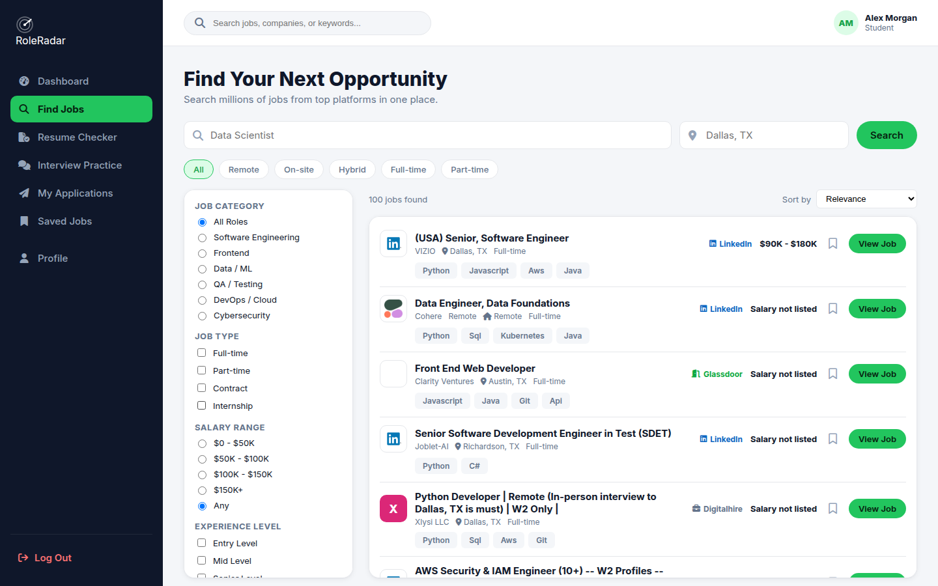
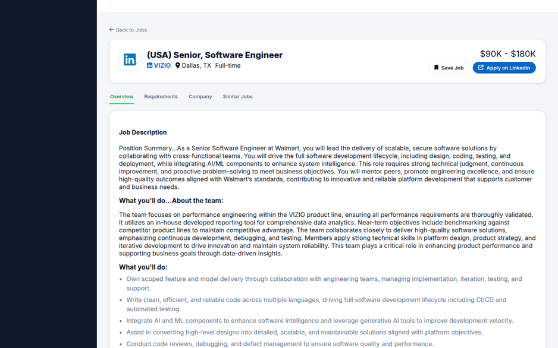
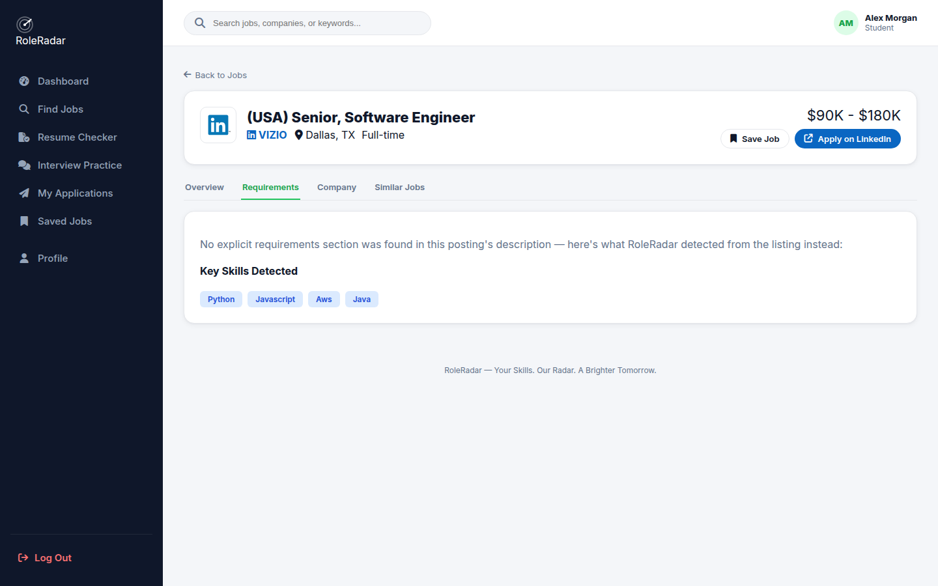
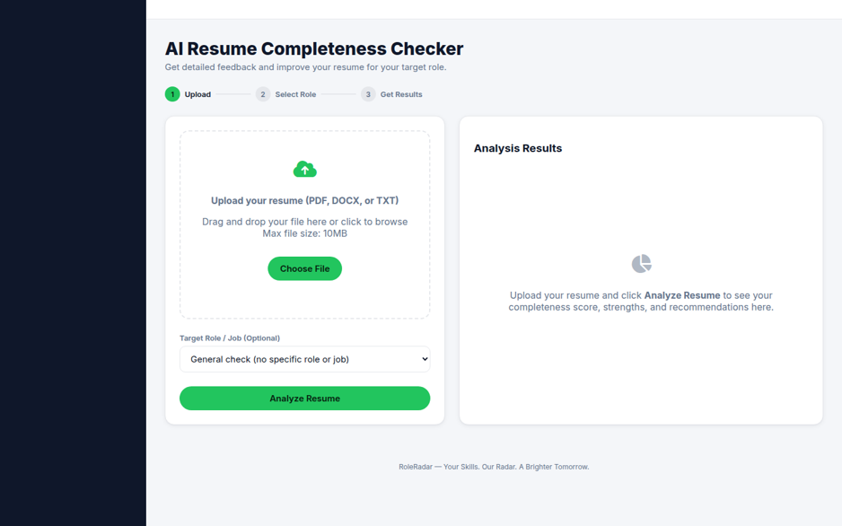
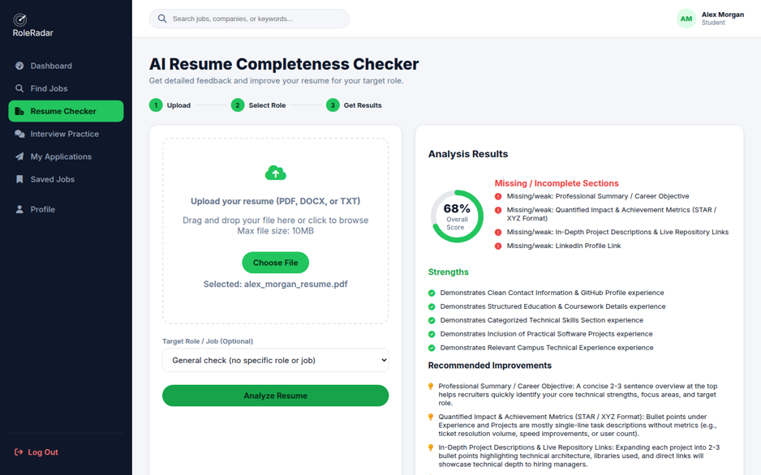
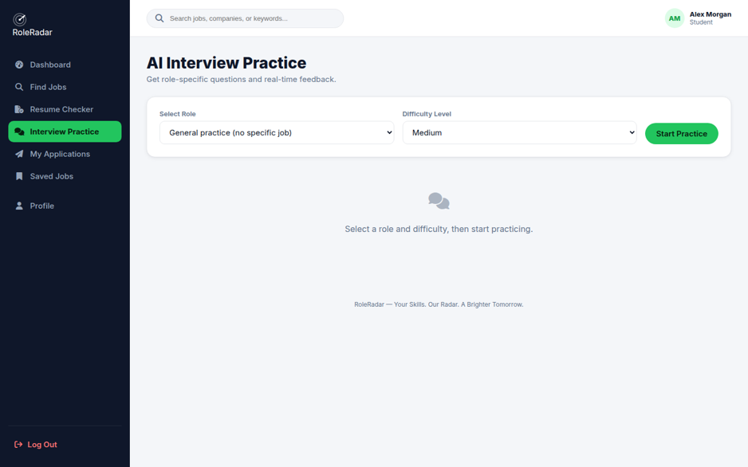
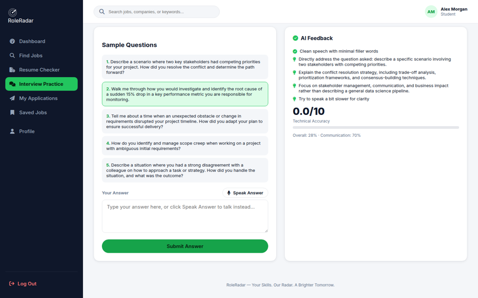

# RoleRadar – User Manual
**Version:** 01
**Team Name:** Techmen
**Date:** 10/11/2026
---
## 1. Introduction
RoleRadar puts job search, resume feedback, and interview practice all in one place. It collects real job listings from top job platforms, evaluates resumes against specific roles or job postings using AI, and lets users practice interview questions with real-time feedback. It is designed for job seekers looking to streamline and manage their entire career search workflow efficiently.
---
## 2. System Requirements
- **Hardware:** A computer with an active internet connection.
- **Software:** A web browser including Chrome, Edge, and Firefox. Voice-answering features require Chrome or Edge.
- **Other Dependencies:** Access to external services for live job search and Google Gemini AI features. Resume file prepared in PDF, DOCX, or TXT format (10 MB or smaller). If running locally, backend server on port 8000 and frontend server.
---
## 3. Installation Guide
No installation required—access via URL (or clone repository and start the backend server on port 8000 and frontend if running locally).
---
## 4. Getting Started
1. Open the application landing page in your browser and click **Sign Up** to create an account with your full name, email address, and a password of at least 8 characters, then verify your email via the link sent to your inbox.
2. Log in using your verified email and password to access your dashboard, where you can view job statistics, quick actions, and overall progress.
---
## 5. Features & Functions
### Feature 1: Job Search
Allows users to search millions of live job listings from top platforms, filter results by category, type, salary, and experience, inspect full job details, and open the original posting on the publishing site
How to use: Type a role or keyword and location in the search bar on the Find Jobs page, click Search, use the left sidebar filters to narrow results, and click **View Job** to inspect details or **Apply on [Source Website]** to open the original listing.

### Feature 2: AI Resume Completeness Checker
Uploads a resume file (PDF, DOCX, or TXT up to 10MB) and uses AI to analyze completeness, strengths, missing sections, and target role or specific job match scores.
How to use: Navigate to Resume Checker from the sidebar, choose or drag and drop your resume file, select a target role or specific job from the dropdown menu, and click **Analyze Resume** to read feedback, scores, and recommendations.

### Feature 3: AI Interview Practice
Generates role-specific or job-specific interview questions by difficulty level and gives real-time AI feedback on typed or spoken answers.
How to use: Open Interview Practice from the sidebar, select a role or job and a difficulty level (Easy, Medium, or Hard), click **Start Practice**, type or speak your answer to the highlighted question, and submit to review technical accuracy, strengths, and communication metrics.

---
## 6. Troubleshooting examples
| Problem | Cause | Solution|
|---------|-------|---------|
| “Error loading jobs” or an empty list | The RoleRadar server cannot be reached. | Check your connection and refresh. If running locally, start the backend (port 8000) and frontend, then refresh. |
| “AI analysis unavailable — showing local estimate” | The AI service is busy or its usage limit was reached. | Wait a minute or two and run Analyze Resume again. |
| My resume will not upload | Unsupported file type or file larger than 10 MB. | Use a PDF, DOCX, or TXT file under 10 MB. |
| Speak Answer is missing or does not record | Browser does not support speech recognition or the microphone is blocked. | Use Chrome or Edge, allow microphone access from the address bar, or type your answer. |
| I never received the verification email | The message is in spam or the email address was mistyped. | Check spam folder, then choose Resend email (once a minute). If mistyped, sign up again with the correct address. |
---
## 7. Contact Information
- **Support Email:** roleradar.support@gmail.com
- **Website:** https://roleradar-tkj5.onrender.com/index.html
- ** Project Repository:** https://github.com/jcTimpani/RoleRadar

## 8. FAQ (Optional – Extra Credit)
**Q:** Can RoleRadar submit job applications on my behalf?
**A:** No, RoleRadar does not submit job applications for you. Clicking "Apply on [Source Website]" takes you to the real listing on the original publishing site where you can complete your application, and it will automatically be added to your "My Applications" tab.

**Q:** Where is my personal data and application history saved?
**A:** Your saved jobs, applications, and profile details are stored locally in your current browser. If a different account logs in on the same browser, RoleRadar starts clean to protect user data.